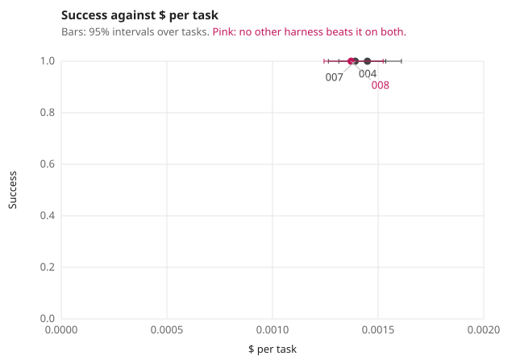
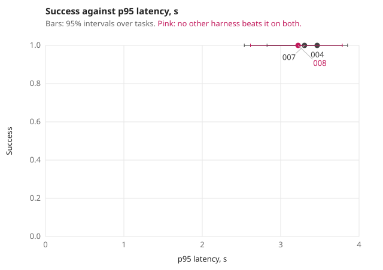

# Campaign on sql-desk

- Saved use case: `sql-desk` v3. Regraded with `sql-desk` v3.
- Model held fixed: `gpt-6.2-sol`
- Runs per task: 3 on development, 3 on validation, 3 on test
- Adoption rule: one step of a loop, intervals at 95.00%; objective `cost_per_task`
- The campaign proposed 8 candidates and adopted 7. Regrading supports 7 on the recorded path.
- Improver: $0.40 known cost in 5.9 minutes.
- Evaluation: 1512 runs of candidates in 8.9 minutes, 108 more for the noise check and 432 on the test tasks
- All evaluation phases: 2052 runs, $3.0503 in reported costs.
- Recorded stop: reached 8 candidates
- Noise check, the starting harness against itself on new samples: success +0.00 (+0.00 to +0.00), inconclusive: as it should be
- With intervals at 99.38%, sensitivity check across 8 candidates: 008 (adopt becomes inconclusive)

## Every candidate

Development screens and validation decisions are recomputed from saved runs. A decision without grading evidence is marked as recorded only. Test scores describe the harnesses the campaign actually tested.

| Candidate | Change to | Development success | Validation success | Difference on validation | Decision | Why |
|---|---|---|---|---|---|---|
| 000 |  | 1.00 | 1.00 (1.00–1.00) |  | start | the starting harness |
| 001 | 000 | 1.00 | 1.00 (1.00–1.00) | +0.00 (+0.00 to +0.00) | adopted | cost_per_task is lower: -0.00012 to -0.00009; success holds: +0.000 to +0.000, no lower than -0.02 |
| 002 | 001 | 1.00 | 1.00 (1.00–1.00) | +0.00 (+0.00 to +0.00) | adopted | cost_per_task is lower: -0.00018 to -0.00016; success holds: +0.000 to +0.000, no lower than -0.02 |
| 003 | 002 | 1.00 | 1.00 (1.00–1.00) | +0.00 (+0.00 to +0.00) | adopted | cost_per_task is lower: -0.00009 to -0.00007; success holds: +0.000 to +0.000, no lower than -0.02 |
| 004 | 003 | 1.00 | 1.00 (1.00–1.00) | +0.00 (+0.00 to +0.00) | adopted | cost_per_task is lower: -0.00006 to -0.00004; success holds: +0.000 to +0.000, no lower than -0.02 |
| 005 | 004 | 1.00 | 1.00 (1.00–1.00) | +0.00 (+0.00 to +0.00) | adopted | cost_per_task is lower: -0.00002 to -0.00001; success holds: +0.000 to +0.000, no lower than -0.02 |
| 006 | 005 | 1.00 | not run |  | screened on dev | development cost_per_task 0.001336 is not below the base's 0.001329 |
| 007 | 005 | 1.00 | 1.00 (1.00–1.00) | +0.00 (+0.00 to +0.00) | adopted | cost_per_task is lower: -0.00004 to -0.00001; success holds: +0.000 to +0.000, no lower than -0.02 |
| 008 | 007 | 1.00 | 1.00 (1.00–1.00) | +0.00 (+0.00 to +0.00) | adopted | cost_per_task is lower: -0.00002 to -0.00000; success holds: +0.000 to +0.000, no lower than -0.02 |

## What each candidate changed

**001** (adopted). I shortened the SQL-generation prompt and asked the model to omit cosmetic output aliases. This should reduce input and output token costs without removing schema details or stored values used to resolve categorical filters. All development tasks already passed, so this change targets cost rather than a known correctness failure.
Files: `desk.py` (+4 −7). Diff: `candidates/001/patch.diff`.

**002** (adopted). I compacted the schema sent to the model by collapsing formatting whitespace and removing repeated `CREATE TABLE` prefixes, while preserving identifiers, types, constraints, and quoted values. The stored-value lookup still uses the original schema. All development tasks already passed, so this change targets lower input-token cost rather than a known correctness failure.
Files: `desk.py` (+19 −1). Diff: `candidates/002/patch.diff`.

**003** (adopted). I shortened the stored-text portion of the model prompt by displaying simple categorical values without redundant quotes and retaining quotes where they prevent ambiguity. The same domains pass the same inclusion checks, so the model still sees exact values for filters and CASE expressions. All development tasks already passed, so this change targets input-token cost rather than a known correctness failure.
Files: `desk.py` (+18 −2). Diff: `candidates/003/patch.diff`.

**004** (adopted). I shortened the schema sent to the model by rendering repeated `PRIMARY KEY` and `NOT NULL` constraints as `PK` and `NN`, with a legend defining the abbreviations. Quoted text, stored-value hints, and query behavior are unchanged. All 24 development tasks already passed, so this change targets lower input-token cost rather than a known correctness failure; the savings have not been measured.
Files: `desk.py` (+16 −3). Diff: `candidates/004/patch.diff`.

**005** (adopted). I tightened the schema shown to the model by removing redundant spaces before opening parentheses and just inside parentheses, while preserving quoted text, comments, and stored-value hints. This is intended to reduce input-token cost without changing the schema information or adding model calls. All 24 development tasks already passed, so this targets cost rather than a known failure; the savings have not been measured.
Files: `desk.py` (+7 −1). Diff: `candidates/005/patch.diff`.

**006** (screened on dev). I shortened the fixed SQL-generation prompt and removed redundant blank lines to reduce input tokens on every question. The prompt still requests one read-only SQLite SELECT with no cosmetic aliases, and it receives the same schema and stored-value hints. All 24 development tasks already passed, so this targets cost rather than a known correctness failure; the savings have not been measured.
Files: `desk.py` (+2 −4). Diff: `candidates/006/patch.diff`.

**007** (adopted). I shortened stored-text hints by omitting the table prefix when a simple column name appears only once in the schema. Repeated names stay qualified, and the same exact values are included under the same budget. The development baseline passed all 24 tasks, so this targets input-token cost rather than a known correctness failure. The cost and success impact have not been measured.
Files: `desk.py` (+14 −2). Diff: `candidates/007/patch.diff`.

**008** (adopted). I shortened the schema sent to the model by replacing repeated plain `TEXT` declarations with one legend, but only when all parsed columns have explicit types and enough declarations can be omitted to offset the legend. The database queries and stored-value hints are unchanged. The baseline passed all 24 development tasks, so this targets input-token cost rather than a known correctness failure; the savings have not been measured.
Files: `desk.py` (+48 −6). Diff: `candidates/008/patch.diff`.

## Test tasks, scored once

| Harness | Success | pass^k | Violations | $ per task | $ per success | p50 latency, s | p95 latency, s | Calls per task | Tokens per task | Infra errors | Undecided | valid sql |
|---|---|---|---|---|---|---|---|---|---|---|---|---|
| 000 | 1.00 (1.00–1.00) | 1.00 (k=3) | 0 | $0.00186 (0.00172–0.00204) | $0.00186 (0.00172–0.00204) | 1.94 (1.75–2.18) | 3.53 (2.79–3.80) | 1.00 (1.00–1.00) | 650 (632–669) | 0 | 0 | 1.00 (1.00–1.00) |
| 004 | 1.00 (1.00–1.00) | 1.00 (k=3) | 0 | $0.00145 (0.00131–0.00161) | $0.00145 (0.00131–0.00161) | 1.80 (1.68–2.01) | 3.47 (2.83–3.85) | 1.00 (1.00–1.00) | 478 (461–496) | 0 | 0 | 1.00 (1.00–1.00) |
| 007 | 1.00 (1.00–1.00) | 1.00 (k=3) | 0 | $0.00139 (0.00126–0.00154) | $0.00139 (0.00126–0.00154) | 1.74 (1.61–1.94) | 3.30 (2.54–3.45) | 1.00 (1.00–1.00) | 457 (442–474) | 0 | 0 | 1.00 (1.00–1.00) |
| 008 | 1.00 (1.00–1.00) | 1.00 (k=3) | 0 | $0.00137 (0.00124–0.00152) | $0.00137 (0.00124–0.00152) | 1.79 (1.73–2.09) | 3.22 (2.61–3.79) | 1.00 (1.00–1.00) | 447 (432–465) | 0 | 0 | 1.00 (1.00–1.00) |

| Tasks tagged | 000 | 004 | 007 | 008 |
|---|---|---|---|---|
| easy | 1.00 (12 tasks) | 1.00 (12 tasks) | 1.00 (12 tasks) | 1.00 (12 tasks) |
| hard | 1.00 (12 tasks) | 1.00 (12 tasks) | 1.00 (12 tasks) | 1.00 (12 tasks) |
| medium | 1.00 (12 tasks) | 1.00 (12 tasks) | 1.00 (12 tasks) | 1.00 (12 tasks) |

**008** against **000** on 36 tasks: success +0.000 (+0.000 to +0.000).
Better on 0 tasks, worse on 0 tasks.
Candidate minus base: cost_per_task -0.00049 (-0.00053 to -0.00046); latency_p50 -0.15 (-0.25 to -0.01); latency_p95 -0.31 (-0.82 to +0.22); calls_per_task +0.00 (+0.00 to +0.00); tokens_per_task -202 (-206 to -199); valid sql +0.00 (+0.00 to +0.00).
Decision: **adopt**. cost_per_task is lower: -0.00053 to -0.00046; success holds: +0.000 to +0.000, no lower than -0.02

## The frontier

The start and the candidates scored on validation that miss no gate the start clears and add no critical violation. Of those, these are the ones that no other beats on validation success, cost per task and p95 latency at once. Each was scored on the test tasks.

| Candidate | Validation success | Validation $ per task | Validation p95 latency, s | Validation tokens per task | Test success | Test $ per task | Test p95 latency, s | Test tokens per task |
|---|---|---|---|---|---|---|---|---|
| 004 | 1.00 | $0.00138 | 2.53 | 471 | 1.00 | $0.00145 | 3.47 | 478 |
| 007 | 1.00 | $0.00134 | 2.55 | 452 | 1.00 | $0.00139 | 3.30 | 457 |
| 008 | 1.00 | $0.00133 | 2.55 | 443 | 1.00 | $0.00137 | 3.22 | 447 |

