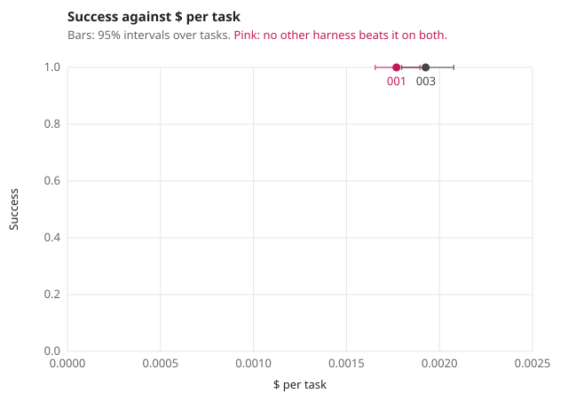
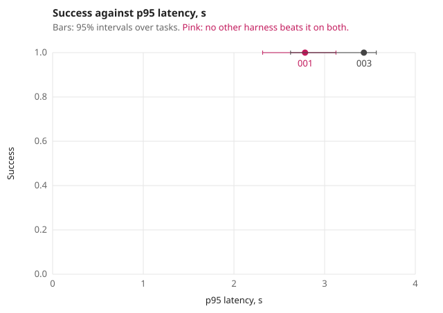

# Campaign on sql-desk

- Saved use case: `sql-desk` v3. Regraded with `sql-desk` v3.
- Model held fixed: `gpt-6.2-sol`
- Runs per task: 3 on development, 3 on validation, 3 on test
- Adoption rule: one step of a loop, intervals at 95.00%; objective `latency_p95`
- The campaign proposed 3 candidates and adopted 0. Regrading supports 0 on the recorded path.
- Improver: $0.16 known cost in 1.6 minutes.
- Evaluation: 1044 runs of candidates in 6.2 minutes, 108 more for the noise check and 324 on the test tasks
- All evaluation phases: 1476 runs, $2.6632 in reported costs.
- Recorded stop: 3 candidates in a row were not adopted
- Noise check, the starting harness against itself on new samples: success +0.00 (+0.00 to +0.00), inconclusive: as it should be
- With intervals at 98.33%, sensitivity check across 3 candidates: the same decisions

## Every candidate

Development screens and validation decisions are recomputed from saved runs. A decision without grading evidence is marked as recorded only. Test scores describe the harnesses the campaign actually tested.

| Candidate | Change to | Development success | Validation success | Difference on validation | Decision | Why |
|---|---|---|---|---|---|---|
| 000 |  | 1.00 | 1.00 (1.00–1.00) |  | start | the starting harness |
| 001 | 000 | 1.00 | 1.00 (1.00–1.00) | +0.00 (+0.00 to +0.00) | inconclusive | latency_p95 changes by -0.37 to +0.34, which does not establish a decrease; keep the base; success holds: +0.000 to +0.000, no lower than -0.02 |
| 002 | 000 | 1.00 | 1.00 (1.00–1.00) | +0.00 (+0.00 to +0.00) | inconclusive | latency_p95 changes by -0.71 to +0.81, which does not establish a decrease; keep the base; success holds: +0.000 to +0.000, no lower than -0.02 |
| 003 | 000 | 1.00 | 1.00 (1.00–1.00) | +0.00 (+0.00 to +0.00) | inconclusive | latency_p95 changes by -0.61 to +0.06, which does not establish a decrease; keep the base; success holds: +0.000 to +0.000, no lower than -0.02 |

## What each candidate changed

**001** (inconclusive). I updated the SQL-generation prompt to request short aliases and omit unrequested display labels, comments, and Markdown. The development baseline had no correctness failures, so this change targets tail latency by reducing the number of tokens generated for longer queries, without changing the schema context, model settings, or requested results. The latency improvement has not been measured.
Files: `desk.py` (+2 −1). Diff: `candidates/001/patch.diff`.

**002** (inconclusive). I updated the SQL-generation prompt to favor a direct SELECT when it returns the same rows, while keeping CTEs and subqueries where separate aggregation levels, window filters, or other logic require them. All development runs already passed, so this change targets tail latency from generating unnecessary query layers rather than a known correctness failure. The latency effect has not been measured.
Files: `desk.py` (+3 −0). Diff: `candidates/002/patch.diff`.

**003** (inconclusive). The existing read-only domain probe now also retrieves small, unambiguous key/value mappings from `shop_meta`. The model can use those live snapshot values directly for dates and unit conversions instead of generating scalar metadata subqueries, with no extra database or model call. All development runs passed at baseline, so this targets tail latency rather than a known correctness failure; the latency impact has not been measured.
Files: `desk.py` (+28 −2). Diff: `candidates/003/patch.diff`.

## Test tasks, scored once

| Harness | Success | pass^k | Violations | $ per task | $ per success | p50 latency, s | p95 latency, s | Calls per task | Tokens per task | Infra errors | Undecided | valid sql |
|---|---|---|---|---|---|---|---|---|---|---|---|---|
| 000 | 1.00 (1.00–1.00) | 1.00 (k=3) | 0 | $0.00186 (0.00171–0.00203) | $0.00186 (0.00171–0.00203) | 1.88 (1.74–2.13) | 3.44 (2.73–3.94) | 1.00 (1.00–1.00) | 649 (632–669) | 0 | 0 | 1.00 (1.00–1.00) |
| 001 | 1.00 (1.00–1.00) | 1.00 (k=3) | 0 | $0.00177 (0.00165–0.00190) | $0.00177 (0.00165–0.00190) | 1.78 (1.68–1.95) | 2.78 (2.32–3.12) | 1.00 (1.00–1.00) | 660 (646–675) | 0 | 0 | 1.00 (1.00–1.00) |
| 003 | 1.00 (1.00–1.00) | 1.00 (k=3) | 0 | $0.00193 (0.00180–0.00208) | $0.00193 (0.00180–0.00208) | 1.78 (1.65–1.90) | 3.43 (2.62–3.57) | 1.00 (1.00–1.00) | 714 (699–732) | 0 | 0 | 1.00 (1.00–1.00) |

| Tasks tagged | 000 | 001 | 003 |
|---|---|---|---|
| easy | 1.00 (12 tasks) | 1.00 (12 tasks) | 1.00 (12 tasks) |
| hard | 1.00 (12 tasks) | 1.00 (12 tasks) | 1.00 (12 tasks) |
| medium | 1.00 (12 tasks) | 1.00 (12 tasks) | 1.00 (12 tasks) |

## The frontier

The start and the candidates scored on validation that miss no gate the start clears and add no critical violation. Of those, these are the ones that no other beats on validation success, cost per task and p95 latency at once. Each was scored on the test tasks.

| Candidate | Validation success | Validation $ per task | Validation p95 latency, s | Validation tokens per task | Test success | Test $ per task | Test p95 latency, s | Test tokens per task |
|---|---|---|---|---|---|---|---|---|
| 001 | 1.00 | $0.00173 | 2.90 | 656 | 1.00 | $0.00177 | 2.78 | 660 |
| 003 | 1.00 | $0.00186 | 2.50 | 708 | 1.00 | $0.00193 | 3.43 | 714 |

